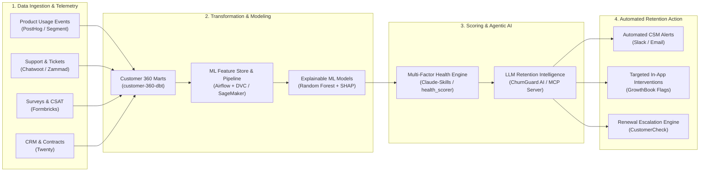
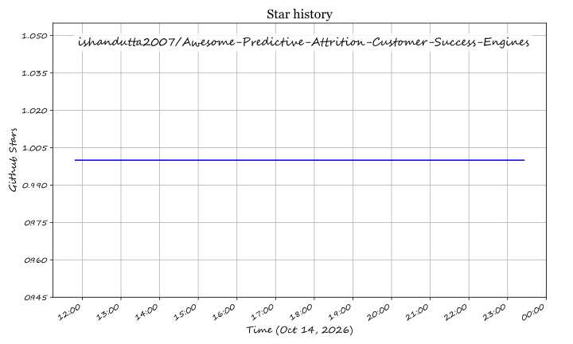

  

  
  
  
  
  
  
  
  

---

# 🚀 Awesome Predictive Attrition & Customer Success Engines

> **The definitive curated directory of Enterprise SaaS Platforms, ML Churn Prediction Pipelines, and Open-Source Customer Retention Engines.**  
> *Engineered for VP of Customer Success, CS Operations Leaders, RevOps Analysts, and Machine Learning Engineers building real-time retention infrastructure.*

---

## 📑 Table of Contents
- [🎯 Overview & Core Concepts](#-overview--core-concepts)
- [🌐 Sector Overview & Market Dynamics](#-sector-overview--market-dynamics)
- [🏢 Enterprise SaaS Platforms Matrix](#-enterprise-saas-platforms-matrix)
- [💻 Open-Source Repositories & Toolkits](#-open-source-repositories--toolkits)
- [🏗️ Architectural Blueprint: Predictive CS Pipeline](#-architectural-blueprint-predictive-cs-pipeline)
- [📖 Retention Metrics & Scoring Glossary](#-retention-metrics--scoring-glossary)
- [🤝 How to Contribute](#-how-to-contribute)
- [⚖️ Disclaimer & Compliance](#-disclaimer--compliance)
- [⭐ Star History](#-star-history)
- [💖 Support](#-support)

---

## 🎯 Overview & Core Concepts

In modern subscription and recurring revenue economics, **Net Revenue Retention (NRR)** and **Gross Revenue Retention (GRR)** dictate SaaS enterprise valuation. Relying on lagging indicators—such as cancellation emails, non-renewal notifications, or overdue invoices—results in reactive firefighting.

**Predictive Attrition & Customer Success Engines** turn customer operations proactive by continuously ingesting:
1. **Product Telemetry**: Declining login frequency, dropped feature adoption depth, session duration collapse, and inactive seat decay.
2. **Relationship & Sentiment Signals**: Delayed response latencies, sponsor/champion turnover, negative ticket sentiment shifts in Zendesk/Slack/email.
3. **Financial & Commercial Indicators**: Contract renewal horizons, billing dispute frequency, discounting pressures, and stagnant license utilization.

These inputs feed deterministic or machine learning-driven **Customer Health Scores (0–100)** to automatically trigger targeted **Retention Playbooks** (automated CSM alerts, executive outreach, in-app adoption guides) before churn becomes irreversible.

---

## 🌐 Sector Overview & Market Dynamics

* **📈 Estimated Market Sizing & Hypergrowth**: The global Customer Success Platform (CSP) and Predictive Churn Analytics market is valued at **$3.40B – $3.61B in 2026** and is projected to expand aggressively to **$8.30B – $14.00B by 2030–2033**, compounding at an estimated **17.9% – 23.4% CAGR**. Growth is heavily accelerated by AI agents, autonomous retention playbooks, and board-level pressure on B2B SaaS companies to protect recurring cash flows.
* **🧩 Market Fragmentation vs. Concentration**: The category displays **moderate concentration at the high-end enterprise tier**, where incumbents (Gainsight and Totango/Catalyst) command substantial market share via deep enterprise ERP/CRM integration. However, the ecosystem remains **highly fragmented across the mid-market, SMB, and open-source segments**. The lack of a single "winner-take-all" monopoly is driven by diverse data realities: some teams require product telemetry-first engines (PostHog, Vitally), others prioritize multi-channel sentiment mining (Staircase AI, ChurnZero), while security-conscious organizations build composable, self-hosted stacks (Twenty, Chatwoot, dbt).

---

## 🏢 Enterprise SaaS Platforms Matrix

The following table compares category-defining SaaS Customer Success and Churn Prediction platforms, **sorted in descending order by company valuation / revenue scale**.

| 🏷️ Platform | 💰 Company Scale (Valuation / ARR) | 💳 Starting Tier Pricing | 🎁 Free Tier / Trial Limits | 🔍 Core Capabilities & Telemetry Focus |
| :--- | :--- | :--- | :--- | :--- |
| **[Gainsight CS](https://www.gainsight.com/)** | **$1.10B Valuation** *(Acquired by Vista Equity; ~$175M ARR)* | **$1,166 / mo** *($14,000/yr base contract; median mid-market ~$49,000/yr)* | **No free tier**; 14-day guided sandbox / POC trial available upon enterprise qualification | Enterprise-grade multi-dimensional health scoring, automated playbook engines, Staircase AI communication intelligence, and deep Salesforce bi-directional sync. |
| **[Totango / Catalyst](https://www.totango.com/)** | **~$450M Valuation** *($150M+ total funding; Series G $100M; ~$35M ARR)* | **$1,000 / mo** *($12,000/yr Starter tier for up to 500 accounts & 2 users)* | **No free tier**; 14-day guided proof-of-concept sandbox trial with sample data | Composable customer journey management, modular SuccessBLOCs, real-time dynamic health profiles, and autonomous expansion signal identification. |
| **[Planhat](https://www.planhat.com/)** | **~$275M Valuation** *($50M Series A led by Sprints Capital; ~$20M ARR)* | **$1,150 / mo** *($13,800/yr billed annually for Start-Up tier)* | **No free tier**; 14-day sales-assisted sandbox POC with live data connectors | Unified customer data studio, direct linkage between health scores and NRR/forecast models, autonomous playbook agents, and unlimited read-only viewer seats. |
| **[ChurnZero](https://churnzero.net/)** | **~$175M Valuation** *($45M total capital; Series B $25M; ~$25M ARR)* | **$1,000 / mo** *($12,000/yr entry contract; mid-market typically $15k–$25k/yr)* | **No free tier**; 14-day sales-assisted trial with custom health score modeling | Real-time ChurnScore threshold alerts, 15+ purpose-built AI CS agents, ChurnZero Connect (MCP) for LLM workflows, and automated customer journey sequences. |
| **[Vitally](https://www.vitally.io/)** | **~$135M Valuation** *($40.6M total funding; Series B $30M via a16z; ~$12M ARR)* | **$299 / mo** *(Starter tier up to 5 users, billed annually; Growth from $1,500/mo)* | **No free tier**; 14-day full-access self-serve trial with pre-built data integrations | Visual real-time health scorecards, Notion-style collaborative client workspaces, native bi-directional Segment/HubSpot sync, and automated CSM alerts. |
| **[Akkio](https://www.akkio.com/)** | **~$60M Valuation** *($17.5M Series A led by Bain Capital Ventures)* | **$49 / mo** *(Starter plan with 1M rows/month and up to 5 user seats)* | **No free tier**; 14-day free trial with 100k data points, full ML training, & churn scoring | No-code predictive machine learning engine; upload tabular usage/billing data to predict customer churn probability and rank top churn-contributing drivers. |
| **[ClientSuccess](https://www.clientsuccess.com/)** | **~$25M Valuation** *($6.0M total funding; acquired Status & Product Signals; ~$3.5M ARR)* | **$750 / mo** *($9,000/yr entry tier for up to 3 CSM seats, billed annually)* | **No free tier**; 14-day guided trial sandbox configured during initial sales consultation | SuccessScore multi-metric customer health matrix, SuccessCycle journey automation, client pulse tracking, and customer onboarding automation modules. |
| **[Staircase AI](https://www.staircase.ai/)** | **~$18M Valuation** *($6.0M Seed funding; acquired by Gainsight in 2024)* | **$1,250 / mo** *($15,000/yr AWS Marketplace 12-month base deployment)* | **No free tier**; 14-day sales-assisted POC analyzing live historical email/Slack threads | Relationship intelligence engine analyzing unstructured communications (email, Slack, Zoom transcripts, Zendesk) for sentiment shifts and champion turnover. |
| **[Custify](https://www.custify.com/)** | **~$12M Valuation** *(Self-funded / bootstrapped; ~$2.5M ARR)* | **$199 / mo** *(Starter tier for early-stage B2B SaaS; Growth tier at $999/mo)* | **No free tier**; 14-day product sandbox trial unlocked upon sales product demo | Turnkey customer success engine for B2B SaaS, automated churn triggers, product adoption scorecards, and low-code lifecycle playbook automations. |
| **[Upscale](https://upscale.ai/)** | **~$5M Valuation** *(Acquired / operations transitioned; ~$5.0M historical funding)* | **$50 / user / mo** *(Starter edition billed annually; legacy tiers up to $75/user/mo)* | **No free tier**; 14-day free trial supporting up to 100 contact enrollments | Multi-channel revenue engagement suite pairing account activity alerts, outbound retention playbooks, and CRM interaction tracking. |

---

## 💻 Open-Source Repositories & Toolkits

Self-hosted frameworks, open-source CRMs, MLOps churn prediction pipelines, and agentic customer analytics tools, **sorted in descending order by GitHub Stars_Count**.

* **[Twenty](https://github.com/twentyhq/twenty)**   
  *Modern open-source CRM alternative to Salesforce.* Provides complete customer 360 profiles, custom pipeline views, GraphQL APIs, and automated task workflows. Serves as the central data and operational hub for customer success managers tracking account health and renewal deadlines.
* **[PostHog](https://github.com/posthog/posthog)**   
  *All-in-one open-source product analytics suite.* Features cohort retention curves, drop-off churn funnels, session recordings, feature flag monitoring, and telemetry event streams. Critical for pinpointing the exact product usage degradation that precedes account cancellation.
* **[Chatwoot](https://github.com/chatwoot/chatwoot)**   
  *Open-source omnichannel customer engagement and helpdesk platform.* Tracks conversation response times, resolution SLAs, and account-level custom attributes across live chat, email, and social channels to capture support frustration signals before churn strikes.
* **[Customer Success Manager Agent Skills (Claude Skills)](https://github.com/alirezarezvani/claude-skills)**   
  *Production-grade CLI customer success toolkit in pure Python (zero external dependencies).* Includes `health_score_calculator.py` (configurable multi-dimensional weighting across Product, Relationship, and Outcome pillars), `churn_risk_analyzer.py` (risk stratification across Enterprise, Mid-Market, and SMB tiers), and `expansion_opportunity_scorer.py`.
* **[Formbricks](https://github.com/formbricks/formbricks)**   
  *Privacy-first, self-hosted experience management and survey suite.* Enables targeted in-app micro-surveys for Net Promoter Score (NPS), Customer Satisfaction (CSAT), and cancellation exit interviews to feed real-time sentiment telemetry into scoring models.
* **[GrowthBook](https://github.com/growthbook/growthbook)**   
  *Open-source feature flagging and experimentation engine.* Enables CS and product teams to roll out retention-focused workflows, track feature adoption cohorts, and run statistical A/B tests to measure how feature interventions reduce churn.
* **[Zammad](https://github.com/zammad/zammad)**   
  *Enterprise-ready open-source ticketing and customer communication system.* Centralizes inbound support requests, tracks ticket escalations, and surfaces unresolved customer friction points feeding into risk assessment algorithms.
* **[Fider](https://github.com/getfider/fider)**   
  *Open-source voice-of-the-customer and product feedback voting platform.* Collects and ranks user feature requests, illuminating critical product gaps that lead key enterprise customer segments to consider competing platforms.
* **[Frappe Helpdesk](https://github.com/frappe/helpdesk)**   
  *Modern, customizable open-source service desk built on the Frappe framework.* Features automated ticket assignment, SLA breach warnings, customer satisfaction analytics, and seamless integration with ERPNext.
* **[health_scorer.py (Claude-Skills)](https://github.com/borghei/Claude-Skills)**   
  *Standalone Python customer health scoring script.* Implements balanced multi-factor scoring: Product (login frequency, feature depth, user ratios), Relationship (executive touches, NPS), and Outcomes (demonstrated ROI). Generates 0–100 health grades and categorized remediation playbooks.
* **[Telecom Customer Churn Prediction](https://github.com/Pradnya1208/Telecom-Customer-Churn-prediction)**   
  *End-to-end churn prediction framework with Explainable AI.* Combines survival analysis and Random Forest classification with SHAP (SHapley Additive exPlanations) values to explain why specific accounts are churning, packaged in a lightweight Flask web app.
* **[ChurnGuard AI](https://github.com/jaideep005/churn_retention_system)**   
  *Retention intelligence web application powered by Streamlit, Scikit-Learn, and LLMs.* Features automated ETL feature engineering, cross-validated classification models, interactive executive dashboards, and AI-synthesized custom retention intervention plans using OpenAI GPT / Google Gemini.
* **[AWS Customer Churn Pipeline](https://github.com/awslabs/aws-customer-churn-pipeline)**   
  *Enterprise cloud reference architecture by AWS Labs.* Orchestrates automated churn modeling using Amazon SageMaker, AWS Step Functions, and XGBoost to train, tune, deploy, and monitor scalable cloud-native churn classification endpoints.
* **[attribution-playbook](https://github.com/dbt-labs/attribution-playbook)**   
  *dbt-labs data modeling package for conversion and attribution analytics.* Utilizes Markov chains and Shapley values to trace customer acquisition sources, enabling CS and RevOps teams to analyze churn rates across specific marketing cohorts and acquisition channels.
* **[churn-prediction-ml-pipeline](https://github.com/anandsuraj/churn-prediction-ml-pipeline)**   
  *Production MLOps pipeline for customer churn forecasting.* Orchestrated via Apache Airflow with DVC data versioning, SQLite schema management, automated feature transformation, model retraining, and drift monitoring.
* **[customer-360-dbt](https://github.com/ndleah/customer-360-dbt)**   
  *Kimball-style 3-layer dbt dimensional model for unifying customer data.* Incorporates PII data masking at the staging layer, dimensional marts, and automated freshness tests, providing the unified foundation layer necessary for health scoring.
* **[gtm-agent-user-health-analyzer](https://github.com/tushar-badhwar/gtm-agent-user-health-analyzer)**   
  *Model Context Protocol (MCP) server for Claude Desktop.* Analyzes account health by evaluating usage telemetry (login cadence, session length), CRM history, and support tickets via `analyze_customer_health` and `get_recommendations` tools.
* **[nextcloud-customercheck](https://github.com/aSoftwareByDesignRepository/nextcloud-customercheck)**   
  *Nextcloud-native CRM tailored for customer success rituals.* Features Company 360 profiling, shared team mailboxes, key account coverage tracking, and an automated renewal engine executing strict `60 / 30 / 7 / 0 / +7` day alerts.

---

## 🏗️ Architectural Blueprint: Predictive CS Pipeline

To build a modern, sovereign, self-hosted Predictive Attrition Engine using the open-source tools listed above, orchestrate the following 4-tier pipeline:

---

## 📖 Retention Metrics & Scoring Glossary

| 📐 Metric / Concept | 🔍 Definition & Operational Formula | 🎯 CS Strategic Relevance |
| :--- | :--- | :--- |
| **Gross Revenue Retention (GRR)** | `(Starting ARR - Churn - Contraction) / Starting ARR` *(Excludes expansion; Max 100%)* | Measures intrinsic product value and whether your core product retains existing dollars without cross-sell reliance. |
| **Net Revenue Retention (NRR)** | `(Starting ARR + Expansion - Churn - Contraction) / Starting ARR * 100` | The primary indicator of SaaS compound growth; top-quartile enterprise B2B SaaS benchmarks exceed **115%–125%**. |
| **Customer Health Score (CHS)** | Weighted composite index `(w1*Usage + w2*Sentiment + w3*Business ROI) / 100` | Real-time 0–100 numerical representation of customer relationship vitality; categorizes accounts into Green, Yellow, and Red tiers. |
| **Telemetry Degradation Signal** | `Δ(Active Users) < -25%` over 14-day rolling window or `Login Frequency Drop > 40%` | Highest-confidence leading indicator of unannounced churn; catches passive attrition weeks before cancellation requests. |
| **Executive Sponsor Turnover** | Detection of primary contract buyer email bounce or LinkedIn job transition | Second leading cause of mid-market/enterprise churn; immediately triggers an account re-onboarding playbook. |
| **SHAP Value Explainability** | Marginal feature contribution in tree models: `ϕ_i = Σ [|S|!(|F|-|S|-1)! / |F|!] * (f(S∪{i}) - f(S))` | Eliminates black-box ML predictions by telling CSMs *precisely why* an account is at risk (e.g. "80% risk caused by lack of SSO configuration"). |

---

## 🤝 How to Contribute

Contributions from the Customer Success, Data Engineering, and RevOps communities are welcome!

1. 🍴 **Fork the repository** on GitHub.
2. 🌿 **Create a descriptive branch**: `git checkout -b feature/add-new-cs-engine`.
3. 📝 **Add or update entries**: Ensure descriptions remain factual, objective, and include verified pricing and trial specifics.
4. 🌟 **Format open-source entries**: Include the shields.io Stars_Badge (`style=social&color=white`) linked directly to the repository's stargazers page.
5. 🚀 **Submit a Pull Request** with a concise summary of changes and sources.

---

## ⚖️ Disclaimer & Compliance

* **Estimates vs. Human Judgment**: Customer health scores, churn probabilities, and automated risk tiers are probabilistic indicators designed to augment—not replace—the domain judgment of CSMs and account directors. False positives can exhaust retention teams; false negatives can silently forfeit high-value accounts.
* **Privacy & Telemetry Governance**: Tracking customer communication channels (Slack, email, call recordings) and user behavior must comply with data protection regulations (**GDPR, CCPA, CPRA, SOC2 Type II**) and enterprise employee privacy agreements.
* **Self-Hosted Verification**: Open-source pipelines require regular cross-validation against actual historical retention events to guard against data drift and false signals.

---

##  Star History

---

## 💖 Support

Thank you for visiting and supporting the **Predictive Attrition & Customer Success Engines** ecosystem! If this repository has saved you time, informed your customer retention strategy, or guided your MLOps architecture, please consider supporting the project:

- ⭐ **Star this repository** to improve visibility and help other CS practitioners and developers find it.
- 🍴 **Fork the repo** and submit pull requests to keep the benchmarks, tooling, and pricing data fresh.
- 📢 **Share with peers** across LinkedIn, X/Twitter, and Customer Success communities.
- ☕ **Buy me a coffee / Sponsor**: Support ongoing research, tool evaluations, and maintenance via the [GitHub Sponsor Dashboard](https://github.com/sponsors/ishandutta2007).

  

---

  Maintained with ❤️ for Customer Success Leaders, Retention Architects, and MLOps Engineers.

## Star History

<a href="https://star-history.com/#ishandutta2007/Awesome-Predictive-Attrition-Customer-Success-Engines&Timeline" align="center">
  <picture>
    <source media="(prefers-color-scheme: dark)" srcset="assets/ishandutta2007_Awesome-Predictive-Attrition-Customer-Success-Engines_growth.svg">
    
  </picture>
</a>
